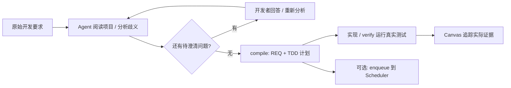

<div align="center">

# REQFlow ARC

### 让一句开发要求，长出可验证的实现路径。

澄清自然语言 → 编译原子需求 → 制定 TDD 计划 → 在 Canvas 追踪代码与测试证据。


[快速开始](#快速开始) · [Canvas 预览](#看见需求如何变成证据) · [完整手册](docs/usage.md) · [Scheduler](https://github.com/Astonomy/scheduler)

</div>

---

## 写代码之前，先让“做好了”有据可查

“帮我实现这个功能”通常还藏着边界条件、依赖和验收口径。ARC 把这些问题留在项目里：先记录要求和真实答复，再生成需求树与测试计划，最后把实际测试结果连回每条需求。

| 开发中的问题 | ARC 提供的落点 |
| --- | --- |
| 原话含糊，Agent 容易自行补充业务规则 | 记录稳定问题 ID 与开发者答复，待澄清问题阻止编译 |
| 一大段需求难以逐项实现 | FOLDER / ATOMIC 需求树与依赖关系 |
| “已经实现”缺少验证方法 | 每个原子 REQ 包含场景、测试 argv、代码/测试路径和 RED 原因 |
| 文档、代码、测试各在一处 | Canvas 展示关联，区分计划与实际运行证据 |
| 想把明确的工作交给夜间执行 | 将已编译 REQ 加入 Scheduler 任务树 |

## 看见需求如何变成证据


*通过 Windows 桌面操作，在 Edge 中打开随仓库附带的本地演示并截图。图中是两数相加的测试夹具，展示失败与通过记录，不代表其他项目已验收；预览为离线快照。*

Canvas 把 **Requirements、Interfaces、Tests** 放在同一张图里。点击节点查看详情，缩放或 Fit 浏览需求关系；UI / API / FUNC / DB 及自定义 scope 帮助组织实现工件。

实时模式只监听 `127.0.0.1`，每两秒读取状态。黄、蓝、绿、红、灰配合文字分别表示计划、执行中、通过、失败和未知，历史失败记录也会保留。



**Agent 负责语义分析，CLI 负责持久化、结构校验和编译。** CLI 本身不调用模型理解任意自然语言；编译成功表示计划可生成，测试通过需要后续真实运行。

## 快速开始

需要 **Python 3.11+、Git、uv**。下面以 Windows PowerShell 为例。运行依赖为 PyYAML；上游 ARC 解析器由脚本检出到固定版本。

```powershell
git clone https://github.com/Astonomy/arc.git
cd arc
./scripts/setup-upstream.ps1
uv sync --locked
./.venv/Scripts/python.exe -m reqflow doctor
```

### 1. 在 Codex 中调用 skill

把仓库内的 [`skills/arc`](skills/arc/SKILL.md) 安装到你的 Codex skills 目录。Windows 通常为 `$CODEX_HOME/skills/arc`；未设置 `CODEX_HOME` 时使用 `~/.codex/skills/arc`。skill 中的运行路径需对应实际克隆位置。

```text
$arc 为 D:/code/my-project 解析以下开发要求，打开 Canvas，
澄清完成后生成 TDD REQ：
提供 add(a,b) 返回两个整数之和，add(2,3) 应返回 5，只需支持整数输入。
```

Agent 阅读项目并编写分析记录；遇到影响实现或验收的歧义会先提问。分析格式和完整 ready 示例见 [analysis.md](skills/arc/references/analysis.md)。

### 2. 用 CLI 保存要求并编译

```powershell
./.venv/Scripts/python.exe -m reqflow intake D:/code/my-project --text '提供 add(a,b) 返回两个整数之和，add(2,3) 应返回 5，只需支持整数输入。'
```

使用返回的 `flow_dir`。以下命令中的 `<flow>` 需替换为该目录；`review.yaml` 由 Agent 按实际项目分析填写，并非 intake 自动生成。

```powershell
./.venv/Scripts/python.exe -m reqflow --flow-dir <flow> analyze --review <flow>/review.yaml

# 如有问题，记录开发者实际答复，再由 Agent 更新 review 并重新 analyze
./.venv/Scripts/python.exe -m reqflow --flow-dir <flow> answer Q-1 '开发者实际答复' --by developer

# ready 后生成 requirements.yaml、requirements.md 和 reqs/*.yaml
./.venv/Scripts/python.exe -m reqflow --flow-dir <flow> compile
./.venv/Scripts/python.exe -m reqflow --flow-dir <flow> serve
```

`serve` 自动打开浏览器并输出实际 URL；停止服务用 Ctrl+C。只想离线查看，可使用 `view --output <flow>/report.html`。

### 3. 让测试结果回到需求上

按 REQ 的计划执行 RED → GREEN → 回归，并通过 `verify` 保存真实运行：

```powershell
./.venv/Scripts/python.exe -m reqflow --flow-dir <flow> verify REQ-ADD --workspace D:/code/my-project --command python -m unittest discover -s tests -v
```

按项目实际环境选择测试解释器和 argv。`verify` 记录退出码、stdout/stderr 与执行状态；`evidence` 可关联代码和测试文件，不能绕过成功测试直接验收。

## 一份要求，一套留在项目里的记录

```text
my-project/.arc/
├── project.yaml
└── requests/<请求ID>/
    ├── source.md               原始要求
    ├── review.yaml             Agent 分析输入
    ├── analysis.yaml           分析、问题与真实答复
    ├── requirements.yaml      编译后的需求树
    ├── requirements.md
    ├── reqs/                   原子 REQ 与 TDD 计划
    ├── traceability.json       验证后的实际证据
    ├── runs/                   测试日志
    └── scheduler.json          可选调度交接索引
```

同一原文复用请求，修订原文建立新请求；编译后的请求保留历史。测试日志和证据在验证后产生，入队索引在交接后产生。

## 白天澄清，夜间推进

搭配独立的 [Codex Scheduler](https://github.com/Astonomy/scheduler)，把已编译 REQ 按依赖排成任务树：

```powershell
./.venv/Scripts/python.exe -m reqflow --flow-dir <flow> enqueue --task D:/scheduler-tasks/my-project.json --workspace D:/code/my-project --state-dir D:/scheduler-state

# 在 scheduler 仓库中启动等待调度
cd ../scheduler
./.venv/Scripts/python.exe -m reqflow_scheduler watch D:/scheduler-tasks/my-project.json --state-dir D:/scheduler-state
```

`enqueue` 只写队列，不启动开发。Scheduler 启动后读取真实账户额度：北京时间 01:00–09:00 连续推进，其他时间在五小时额度重置前 30 分钟最多提交一个节点。调度任务与运行状态保存在目标 workspace 外。

## 深入使用与验证

- [完整使用手册](docs/usage.md)：scope、自定义证据、既有仓库导入、兼容流程和 WSL。
- [分析记录与最小示例](skills/arc/references/analysis.md) · [Codex skill](skills/arc/SKILL.md)。
- [Canvas 验证记录](docs/verification/canvas.md) · [上游复用范围](docs/ARC-AUDIT.md) · [历史设计](PLAN.md)。
- [离线演示 HTML](examples/demo/report.html)：克隆后在本地浏览器打开。

```powershell
./.venv/Scripts/python.exe -m unittest discover -s tests -v
```

ARC 使用 [agentic-requirement-compiler](https://github.com/code-philia/agentic-requirement-compiler) 的契约解析器，固定提交 `5a02a173d33ebd9251b28d97c70f6a0cb5b20deb`。复用范围见审计文档；当前使用源码/可编辑安装，上游不随 wheel 打包。
