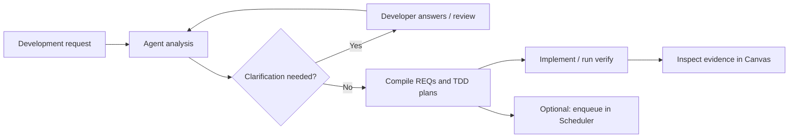

<div align="center">

# REQFlow ARC

A requirements workflow for clarification, TDD planning, and implementation evidence.


**English** · [简体中文](README_zh.md)

[Quick start](#quick-start) · [Canvas](#canvas) · [Usage guide (Chinese)](docs/usage.md) · [Scheduler](https://github.com/Astonomy/scheduler)

</div>

## Overview

ARC records development requests, clarification answers, atomic requirements, and test evidence in the target project. An agent performs semantic analysis; the CLI persists, validates, and compiles the results.

| Capability | Output |
| --- | --- |
| Clarification | Stable question IDs and developer answers; unresolved questions block compilation |
| Requirement decomposition | FOLDER / ATOMIC trees with dependencies and acceptance scenarios |
| TDD planning | Test argv, code and test paths, and an expected RED failure for each atomic REQ |
| Traceability | Canvas links between requirements, implementation artifacts, and test runs |
| Scheduling | Optional export of compiled REQs to a Scheduler task tree |

## Canvas


*Desktop capture of the bundled addition demo in Edge. This offline fixture illustrates failed and successful test runs.*

Canvas displays **Requirements, Interfaces, and Tests** with node details, zoom, Fit, and scope groups such as UI, API, FUNC, and DB. Live mode listens on `127.0.0.1` and refreshes every two seconds.

Color and text distinguish planned, running, passed, failed, and unknown states. Planned artifacts and actual test evidence are recorded separately.



Compilation validates the recorded analysis and plan structure. It does not execute tests or establish semantic correctness.

## Quick start

Requirements: **Python 3.11+, Git, and uv**. Examples use Windows PowerShell. PyYAML is the runtime dependency; the setup script checks out the upstream parser at a pinned revision.

```powershell
git clone https://github.com/Astonomy/arc.git
cd arc
./scripts/setup-upstream.ps1
uv sync --locked
./.venv/Scripts/python.exe -m reqflow doctor
```

### 1. Analyze a request

Install [`skills/arc`](skills/arc/SKILL.md) in your Codex skills directory, typically `$CODEX_HOME/skills/arc` or `~/.codex/skills/arc`. Adjust the skill's runtime paths to the local checkout.

```text
$arc Analyze this request for D:/code/my-project, open Canvas,
and compile TDD requirements after clarification:
Provide add(a,b) for integer inputs. add(2,3) must return 5.
```

The agent reviews the project, records its analysis, and asks the developer about ambiguities affecting implementation or acceptance. See the [analysis format and ready example (Chinese)](skills/arc/references/analysis.md).

### 2. Record and compile

```powershell
./.venv/Scripts/python.exe -m reqflow intake D:/code/my-project --text 'Provide add(a,b) for integer inputs. add(2,3) must return 5.'
```

Use the returned `flow_dir` as `<flow>` below. The agent prepares `review.yaml`; intake does not generate the analysis.

```powershell
./.venv/Scripts/python.exe -m reqflow --flow-dir <flow> analyze --review <flow>/review.yaml

# If clarification is required, record the actual answer.
# The agent must then update review.yaml and run analyze again.
./.venv/Scripts/python.exe -m reqflow --flow-dir <flow> answer Q-1 'Actual developer answer' --by developer

# Compile once the analysis is ready, then open Canvas.
./.venv/Scripts/python.exe -m reqflow --flow-dir <flow> compile
./.venv/Scripts/python.exe -m reqflow --flow-dir <flow> serve
```

`serve` opens the browser and reports its URL. Stop it with Ctrl+C. For an offline snapshot, use `view --output <flow>/report.html`.

### 3. Record test evidence

Follow each REQ's RED → GREEN → regression plan. Use the project's actual interpreter and test command.

```powershell
./.venv/Scripts/python.exe -m reqflow --flow-dir <flow> verify REQ-ADD --workspace D:/code/my-project --command python -m unittest discover -s tests -v
```

`verify` records execution state, exit code, stdout, and stderr. `evidence` associates code and test files with the REQ; acceptance requires successful test evidence.

## Project artifacts

```text
my-project/.arc/
├── project.yaml
└── requests/<request-id>/
    ├── source.md               Original request
    ├── review.yaml             Agent analysis input
    ├── analysis.yaml           Analysis, questions, and answers
    ├── requirements.yaml      Compiled requirement tree
    ├── requirements.md
    ├── reqs/                   Atomic REQs and TDD plans
    ├── traceability.json       Recorded evidence
    ├── runs/                   Test logs
    └── scheduler.json          Optional scheduling index
```

Identical request text reuses the existing request. Revised text creates a new request; compiled requests remain immutable. Evidence and scheduling files are created by their respective workflow steps.

## Scheduler integration

After compilation, enqueue REQs in dependency order:

```powershell
./.venv/Scripts/python.exe -m reqflow --flow-dir <flow> enqueue --task D:/scheduler-tasks/my-project.json --workspace D:/code/my-project --state-dir D:/scheduler-state

# Start polling from the sibling Scheduler checkout.
cd ../scheduler
./.venv/Scripts/python.exe -m reqflow_scheduler watch D:/scheduler-tasks/my-project.json --state-dir D:/scheduler-state
```

`enqueue` writes the task tree without starting execution. [Scheduler](https://github.com/Astonomy/scheduler) queries live quota and dispatches continuously from 01:00 to 09:00 Beijing time, or at most once per five-hour window during the final 30 minutes before reset. Task files and runtime state remain outside the target workspace.

## Documentation

- [Usage guide (Chinese)](docs/usage.md): scopes, evidence, repository import, compatibility, and WSL.
- [Analysis format (Chinese)](skills/arc/references/analysis.md) · [Codex skill (Chinese)](skills/arc/SKILL.md).
- [Canvas verification (Chinese)](docs/verification/canvas.md) · [Upstream reuse audit (Chinese)](docs/ARC-AUDIT.md) · [Historical design (Chinese)](PLAN.md).
- [Offline demo](examples/demo/report.html): open locally after cloning.

Run the test suite:

```powershell
./.venv/Scripts/python.exe -m unittest discover -s tests -v
```

ARC reuses the contract parser from [agentic-requirement-compiler](https://github.com/code-philia/agentic-requirement-compiler), pinned to `5a02a173d33ebd9251b28d97c70f6a0cb5b20deb`. Use a source or editable installation; the upstream parser is not bundled in the wheel.
