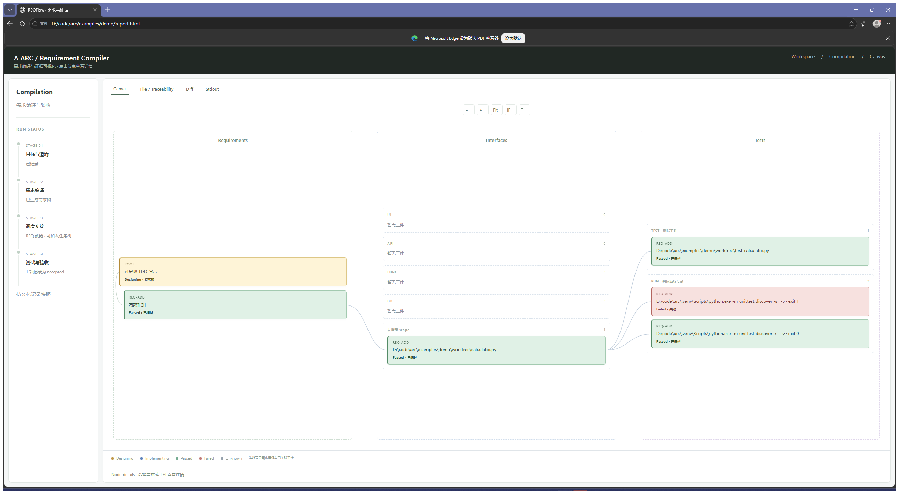
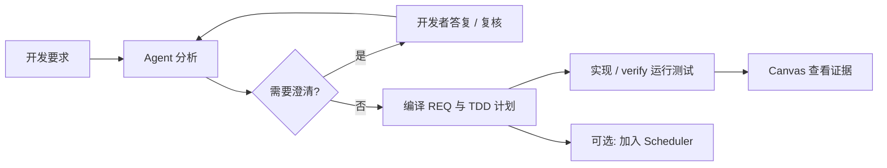

<div align="center">

# REQFlow ARC

面向需求澄清、TDD 计划和实现证据的开发工作流。


[English](README.md) · **简体中文**

[快速开始](#快速开始) · [Canvas](#canvas) · [完整手册](docs/usage.md) · [Scheduler](https://github.com/Astonomy/scheduler)

</div>

## 概述

ARC 在目标项目中保存开发要求、澄清答复、原子需求和测试证据。Agent 负责语义分析，CLI 负责持久化、校验和编译。

| 功能 | 产物 |
| --- | --- |
| 需求澄清 | 稳定问题 ID 和开发者答复；未解决问题阻止编译 |
| 需求拆分 | 包含依赖关系和验收场景的 FOLDER / ATOMIC 需求树 |
| TDD 计划 | 每个原子 REQ 的测试 argv、代码及测试路径、RED 预期 |
| 证据追溯 | Canvas 中的需求、实现工件和测试运行关联 |
| 任务调度 | 可选导出已编译 REQ 至 Scheduler 任务树 |

## Canvas



*在 Edge 中打开仓库附带的加法演示后截取的桌面图片。该离线夹具展示失败与通过的测试运行。*

Canvas 展示 **Requirements、Interfaces、Tests**，支持节点详情、缩放、Fit，以及 UI、API、FUNC、DB 等 scope 分组。实时模式监听 `127.0.0.1`，每两秒刷新。

节点以颜色和文字区分计划、执行中、通过、失败和未知状态。计划工件与实际测试证据分别记录。



编译校验已记录的分析和计划结构，不执行测试，也不证明语义正确性。

## 快速开始

需要 **Python 3.11+、Git、uv**。以下使用 Windows PowerShell。运行依赖为 PyYAML，安装脚本将上游解析器检出至固定版本。

```powershell
git clone https://github.com/Astonomy/arc.git
cd arc
./scripts/setup-upstream.ps1
uv sync --locked
./.venv/Scripts/python.exe -m reqflow doctor
```

### 1. 分析要求

将 [`skills/arc`](skills/arc/SKILL.md) 安装到 Codex skills 目录，通常为 `$CODEX_HOME/skills/arc` 或 `~/.codex/skills/arc`。skill 中的运行路径应对应本地克隆位置。

```text
$arc 为 D:/code/my-project 分析以下开发要求，打开 Canvas，
澄清完成后编译 TDD 需求：
提供 add(a,b) 返回两个整数之和，add(2,3) 应返回 5。
```

Agent 阅读项目并记录分析，对影响实现或验收的歧义向开发者提问。参见[分析格式与 ready 示例](skills/arc/references/analysis.md)。

### 2. 保存与编译

```powershell
./.venv/Scripts/python.exe -m reqflow intake D:/code/my-project --text '提供 add(a,b) 返回两个整数之和，add(2,3) 应返回 5。'
```

将返回的 `flow_dir` 替换到以下 `<flow>`。Agent 编写 `review.yaml`，intake 不自动生成分析。

```powershell
./.venv/Scripts/python.exe -m reqflow --flow-dir <flow> analyze --review <flow>/review.yaml

# 如需澄清，记录真实答复；Agent 随后更新 review.yaml 并再次 analyze
./.venv/Scripts/python.exe -m reqflow --flow-dir <flow> answer Q-1 '开发者实际答复' --by developer

# 分析就绪后编译并打开 Canvas
./.venv/Scripts/python.exe -m reqflow --flow-dir <flow> compile
./.venv/Scripts/python.exe -m reqflow --flow-dir <flow> serve
```

`serve` 打开浏览器并输出 URL，Ctrl+C 停止。离线快照使用 `view --output <flow>/report.html`。

### 3. 记录测试证据

按每个 REQ 的 RED → GREEN → 回归计划执行，使用项目实际解释器和测试命令。

```powershell
./.venv/Scripts/python.exe -m reqflow --flow-dir <flow> verify REQ-ADD --workspace D:/code/my-project --command python -m unittest discover -s tests -v
```

`verify` 保存执行状态、退出码和 stdout/stderr。`evidence` 将代码与测试文件关联至 REQ，验收需要成功的测试证据。

## 项目产物

```text
my-project/.arc/
├── project.yaml
└── requests/<请求ID>/
    ├── source.md               原始要求
    ├── review.yaml             Agent 分析输入
    ├── analysis.yaml           分析、问题和答复
    ├── requirements.yaml      编译后的需求树
    ├── requirements.md
    ├── reqs/                   原子 REQ 和 TDD 计划
    ├── traceability.json       已记录的证据
    ├── runs/                   测试日志
    └── scheduler.json          可选调度索引
```

相同原文复用已有请求，修订原文创建新请求；已编译请求不可覆盖。证据文件和调度文件由相应步骤生成。

## Scheduler 集成

编译完成后，按依赖顺序加入任务树：

```powershell
./.venv/Scripts/python.exe -m reqflow --flow-dir <flow> enqueue --task D:/scheduler-tasks/my-project.json --workspace D:/code/my-project --state-dir D:/scheduler-state

# 在相邻 Scheduler 仓库中启动轮询
cd ../scheduler
./.venv/Scripts/python.exe -m reqflow_scheduler watch D:/scheduler-tasks/my-project.json --state-dir D:/scheduler-state
```

`enqueue` 只写入任务树，不启动执行。[Scheduler](https://github.com/Astonomy/scheduler) 查询真实额度，在北京时间 01:00–09:00 连续调度，其他时段在五小时窗口重置前 30 分钟内最多提交一次。任务文件和运行状态保存在目标 workspace 外。

## 文档

- [完整手册](docs/usage.md)：scope、证据、仓库导入、兼容流程和 WSL。
- [分析格式](skills/arc/references/analysis.md) · [Codex skill](skills/arc/SKILL.md)。
- [Canvas 验证](docs/verification/canvas.md) · [上游复用审计](docs/ARC-AUDIT.md) · [历史设计](PLAN.md)。
- [离线演示](examples/demo/report.html)：克隆后在本地打开。

运行测试：

```powershell
./.venv/Scripts/python.exe -m unittest discover -s tests -v
```

ARC 复用 [agentic-requirement-compiler](https://github.com/code-philia/agentic-requirement-compiler) 的契约解析器，固定提交为 `5a02a173d33ebd9251b28d97c70f6a0cb5b20deb`。请使用源码或可编辑安装，上游解析器不随 wheel 打包。
